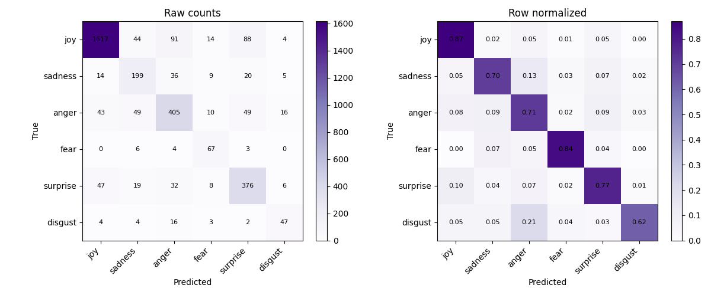

# 🎭 Emotion Classification with Learned Attention

[](https://www.python.org/)
[](https://pytorch.org/)
[](https://huggingface.co/Solayman-Sameh/emotion-classification-with-attention)
[](https://gradio.app/)
[](LICENSE)

An end-to-end English text emotion classifier comparing classical recurrent architectures (**LSTM, GRU, BiLSTM + Additive Attention**) against fine-tuned **DistilBERT** across 6 emotions: *joy, sadness, anger, fear, surprise, and disgust*.

The interactive application pairs Transformer predictions with a dedicated **BiLSTM Attention View**, highlighting token-level attention weights for model interpretability and cross-model comparison.

---

## 📽️ Demo Preview

> **Interactive Gradio Interface**: Live prediction cards, ranked probability distributions, and token-level attention weight bars.

<p align="center">
  <video src="media/emotion-classification-demo.mp4" controls="controls" width="100%" style="max-height: 500px; border-radius: 8px;">
    Your browser does not support the video tag. Watch the demo in <code>media/emotion-classification-demo.mp4</code>.
  </video>
</p>

---

## ⚡ Quickstart (New Device Setup)

Get the project running locally on a clean machine in less than 2 minutes:

### 1. Prerequisites
- **Git**
- **Python 3.11 or 3.12**

### 2. Clone & Environment Setup

#### 🪟 Windows (PowerShell)
```powershell
# Clone the repository
git clone https://github.com/Solayman-Sameh/emotion-classification-with-attention.git
cd emotion-classification-with-attention

# Create virtual environment
python -m venv .venv

# Activate virtual environment
.\.venv\Scripts\Activate.ps1

# Install pinned dependencies
python -m pip install --upgrade pip
pip install -r requirements.txt
```

#### 🐧 Linux / 🍎 macOS
```bash
# Clone the repository
git clone https://github.com/Solayman-Sameh/emotion-classification-with-attention.git
cd emotion-classification-with-attention

# Create virtual environment
python3 -m venv .venv

# Activate virtual environment
source .venv/bin/activate

# Install pinned dependencies
python -m pip install --upgrade pip
pip install -r requirements.txt
```

### 3. Launch the Application

```bash
python app.py
```
Open your browser at **`http://127.0.0.1:7860`**.

> **Note on Model Weights**: On first launch, the app automatically downloads and verifies the pre-trained model bundle (~274 MB) from Hugging Face (`Solayman-Sameh/emotion-classification-with-attention`). Subsequent runs launch instantly from your local cache (`~/.cache/emotion_models`).

<details>
<summary>🛠️ <b>Offline Mode & Pre-caching Utilities</b> (Click to expand)</summary>

If working in an air-gapped or restricted environment, preload the models beforehand:

```bash
# Pre-download and verify SHA-256 hashes
python application/download_models.py

# Verify cache integrity without internet access
python application/download_models.py --offline
```
</details>

---

## 📊 Benchmark & Results

All models were evaluated on the filtered, single-label GoEmotions subset (26,517 train / 3,342 val / 3,357 test). Model selection was frozen based on validation macro F1.

| Architecture | Test Accuracy | Test Macro F1 | Val Macro F1 | Parameter Size |
| :--- | :---: | :---: | :---: | :---: |
| 🥇 **DistilBERT (Selected)** | **80.76%** | **0.7179** | **0.7077** | ~67M |
| 🥈 **BiLSTM + Attention** | **74.71%** | **0.6517** | **0.6552** | ~2.5M |
| 🥉 **GRU** | 73.58% | 0.6389 | 0.6429 | ~1.8M |
| 4️⃣ **LSTM** | 71.19% | 0.6191 | 0.6257 | ~1.9M |

<p align="center">
  
  <br>
  <em>Figure: Normalized test confusion matrix for the fine-tuned DistilBERT model.</em>
</p>

---

## 📂 Project Directory Structure

```text
emotion-classification-with-attention/
├── app.py                      # Root launcher for Gradio application
├── requirements.txt            # Application dependencies (-r application/requirements.txt)
├── upload_to_hf.py             # Deployment utility to Hugging Face Hub
│
├── application/                # Production inference engine
│   ├── app.py                  # Gradio UI definition, custom CSS & layout
│   ├── download_models.py      # Checksum-verified model fetcher from HF
│   ├── inference.py            # Dual-model inference & attention HTML renderer
│   ├── models/                 # Model architecture definitions (BiLSTM, GRU, LSTM)
│   ├── tokenizer/              # Tokenizer assets and vocab mappings
│   └── requirements.txt        # Pinned runtime dependencies
│
├── media/                      # Demo recordings & UI showcases
│   └── emotion-classification-demo.mp4
│
├── notebooks/                  # Training pipelines & reproducible research
│   ├── emotion_classification_all_in_one.ipynb # Executable cloud training run
│   └── instant-sprint...ipynb  # Baseline exploratory work
│
├── reports/                    # Empirical evaluations & metrics
│   ├── final_test/             # Per-model confusion matrices & classification reports
│   ├── ERROR_ANALYSIS.md       # Qualitative error study (minority class breakdown)
│   └── model_comparison.csv    # Consolidated experiment results
│
├── tests/                      # Automated test suite
│   ├── test_loading.py         # Model loading & hash integrity checks
│   └── test_presentation.py    # UI rendering, HTML escaping & token alignment
│
└── docs/                       # Project documentation & release notes
    ├── Project_Proposal.md     # Initial problem formulation & architecture plan
    ├── Demo_Guide.md           # Script & user flows for demonstrations
    └── Release_Verification.md # Audit log of test passes & validation checks
```

---

## 🧪 Verification & Testing

Run the automated test suite to verify loading integrity, attention HTML rendering, and formatting:

```bash
python -m unittest discover -s tests -v
```

---

## 🧠 Key Learnings & Limitations

1. **Attention vs. Performance**: Adding bidirectional recurrence and additive attention gave a **+3.26 percentage point boost** in macro-F1 over standard LSTM, while revealing which words dominate the prediction.
2. **Minority Class Sparsity**: Fear (80 test instances) and Disgust (76 test instances) have limited representation in GoEmotions, causing higher variance on these emotions.
3. **Interpretability**: Token attention scores are inspection aids for model focus, not causal explanations of human emotional state.

---

## 📄 License & Attribution

- **Code**: [MIT License](LICENSE)
- **Dataset**: Derived from Google's [GoEmotions](https://github.com/google-research/google-research/tree/master/goemotions)
- **Embeddings**: Pre-trained [GloVe-50d](https://nlp.stanford.edu/projects/glove/)
